<!-- Los destinos de los paneles se editan en los href de este archivo. -->

<a href="https://mi-primera-web-lilac.vercel.app/"><picture><source media="(max-width: 560px)" srcset="./cards/inicio-movil.svg" /></picture></a> 
&nbsp;&nbsp;

<a href="https://gpazop.github.io/">Terminal interactiva</a>

## Proyectos destacados

 
 

## Formación

Estudio Ingeniería de Sistemas en la Universidad César Vallejo. Desarrollo aplicaciones web y exploro datos e IA con Python. Mi experiencia en el INEI incluye coordinación de equipos de campo para la recopilación de datos censales.

- **AWS Training & Certification** · Insignia de formación AWS Knowledge: Cloud Essentials. Cursos destacados en fundamentos técnicos, DevOps, redes, observabilidad de Amazon EC2, gestión de costos e IA generativa.
- **Redes, soporte e IA** · Cisco Networking Academy, *CCNA: Introduction to Networks* · Universidad César Vallejo, certificación progresiva de Asistente de Help Desk · Red Hat Academy, *Introduction to Red Hat OpenShift AI*.

Ver más formación AWS

- **Infraestructura y seguridad** · AWS Technical Essentials, AWS Networking Basics, monitoreo y resolución de problemas de redes, Amazon ECS, IAM, AWS Security Hub y evaluación de la insignia de Amazon EKS.
- **DevOps, costos y datos** · Getting Started with DevOps on AWS, AWS Billing and Cost Management, AWS Database Offerings y AWS Compute Services Overview.
- **IA y aprendizaje automático** · Fundamentals of Machine Learning and Artificial Intelligence, Foundations of Prompt Engineering e Introduction to Generative AI.
- **Preparación para el examen** · Official Practice Question Set de AWS Certified Cloud Practitioner (CLF-C02).

